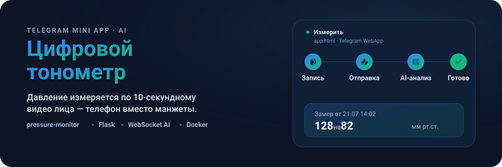
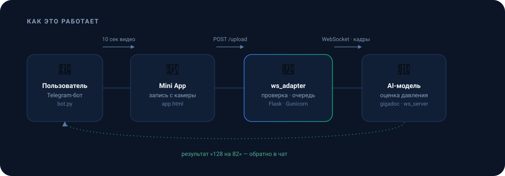

<p align="center">
  
</p>

## Что это

**Цифровой тонометр** — эксперимент по измерению артериального давления без манжеты. Пользователь открывает Telegram-бота, 10 секунд снимает своё лицо на камеру телефона, а AI-модель оценивает давление по видео и присылает результат обратно в чат.

Проект сейчас в стадии тестирования: бот прямо предупреждает об этом каждого, кто открывает мини-приложение, и логирует каждый замер, чтобы модель можно было дообучать.

## Как это работает

<p align="center">
  
</p>

1. `/start` в боте → кнопка **«🩺 Измерить»** открывает Mini App ([`app.html`](app.html)) как Telegram WebApp.
2. Mini App записывает 10 секунд видео с камеры и отправляет его в `ws_adapter` (`POST /upload`, Bearer-токен, минимум 640×480 и 10 секунд).
3. `ws_adapter` ставит видео в очередь, разбивает на кадры и передаёт их AI-модели (`gigadoc`) по WebSocket.
4. Результат вида «128 на 82» возвращается в Mini App и дублируется ботом в чат; замер добавляется в `measures.log`.

## Стек

| Компонент | Роль | Технологии |
| --- | --- | --- |
| [`telegram_bot/`](telegram_bot) | UI бота, приём результата | python-telegram-bot |
| [`app.html`](app.html) + [`styles.css`](styles.css) | Mini App: запись видео, прогресс, результат | Telegram WebApp JS |
| [`ws_adapter/`](ws_adapter) | Приём видео, валидация, очередь, мост к AI по WebSocket | Flask, Gunicorn, OpenCV |
| `gigadoc` (внешний образ) | AI-модель оценки давления по видео | WebSocket-сервер |
| [`video_server/`](video_server) | Упрощённый приёмник видео для отладки | Flask |

## Быстрый старт

Нужны Docker, Docker Compose и образ AI-модели `ws_gigadoc_cpu` (поставляется отдельно, не входит в репозиторий).

```bash
git clone https://github.com/antonio-litvinov/pressure-monitor
cd pressure-monitor

cp .env.example .env   # заполнить TOKEN и GIGADOC_TOKEN

docker load -i ws_gigadoc_cpu.tar.gz
docker compose build
docker compose up -d
```

| Переменная | Назначение |
| --- | --- |
| `TOKEN` | токен Telegram-бота |
| `GIGADOC_TOKEN` | Bearer-токен для `/upload` и связи с `ws_adapter` |
| `SUPABASE_URL`, `SUPABASE_KEY` | доступ к Supabase (зависимость объявлена в `telegram_bot/requirements.txt`, в коде бота пока не используется) |

Полная инструкция по серверу — пользователь и SSH, домен и HTTPS, файрвол, автоперезапуск по cron — вынесена в [`docs/server-setup.md`](docs/server-setup.md).

## Ограничения

- Видео короче 10 или длиннее 20 секунд отклоняется или обрезается.
- Минимальное разрешение — 640×480; лицо должно быть хорошо освещено и полностью в кадре.
- Загруженные видео и результаты живут не дольше `MAX_FILE_TTL_SEC` (по умолчанию 5 минут), затем удаляются.
- Проект не является медицинским изделием и не заменяет сертифицированный тонометр.
